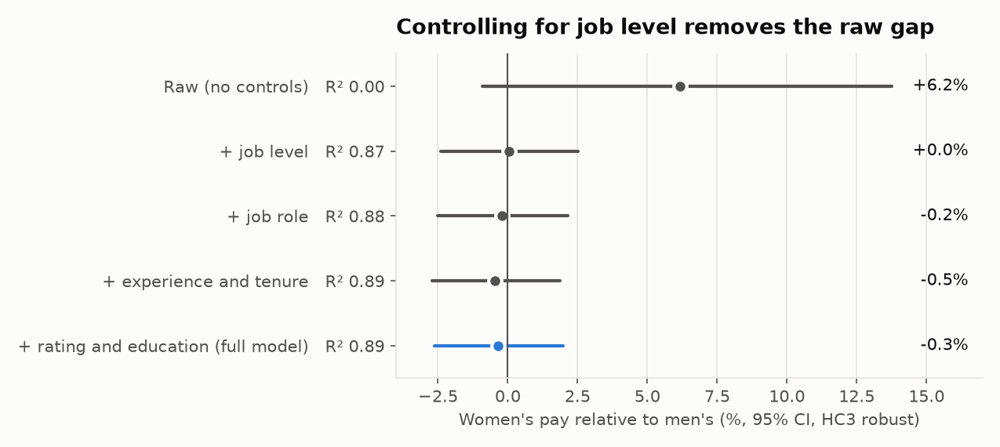
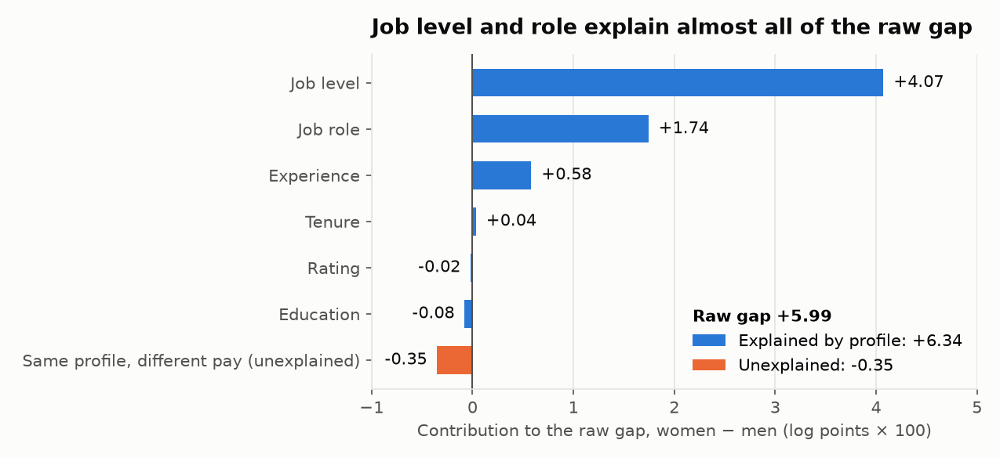
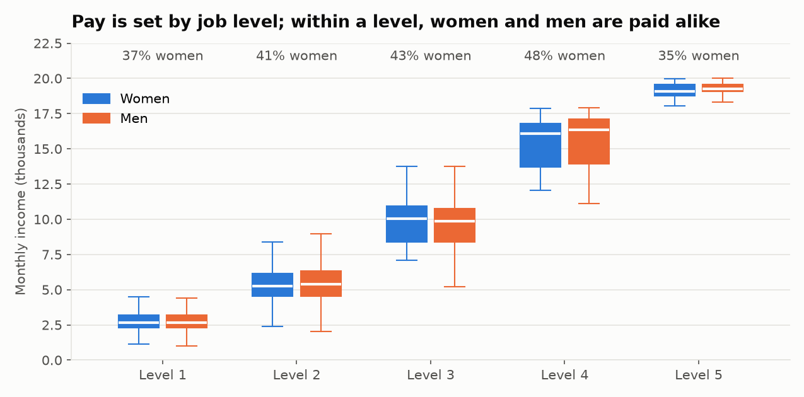
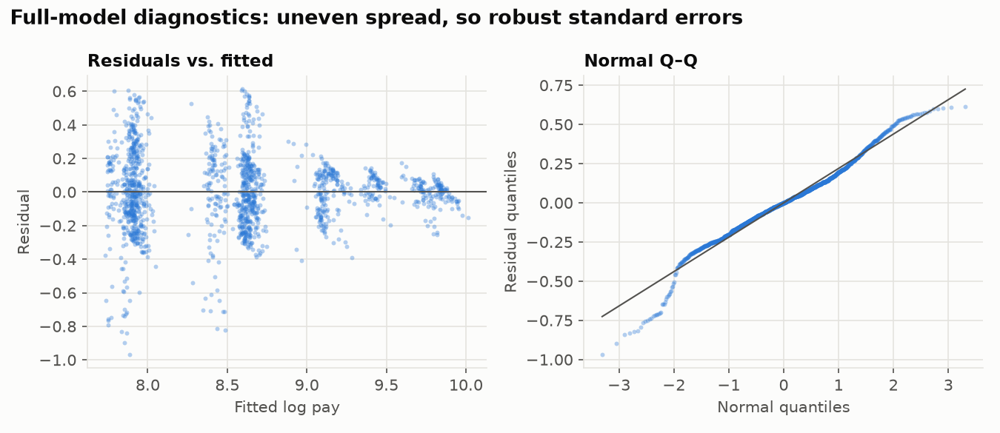

# HR Pay-Equity Audit: Is There a Gender Pay Gap?

**No. Women in this company earn 6.2% more than men on average, but that is because more of them
sit in senior job levels and better-paid roles. Comparing like with like (same level, role,
experience, tenure, rating and education), women earn 0.3% less, with a 95% CI of −2.6% to +2.0%.
That is statistically zero, and the interval rules out a hidden gap larger than about 2.6%.
Women also reach senior levels at the same rate as men with the same experience.**

This is the analysis an HR analytics team runs before a pay review: measure the raw gap, explain
it with regression, test whether the explanation itself hides bias, check the model's
assumptions, and hand HR a list of individual cases to review.

| Question | Answer | Evidence |
|---|---|---|
| Raw gap (women vs. men) | +6.2% | Mean log pay, 1,470 employees |
| Gap for the same profile | −0.3% (95% CI −2.6% to +2.0%), p = 0.77 | OLS on log pay, HC3 robust errors |
| What explains the raw gap? | Job level (+4.1 pts) and job role (+1.7 pts) | Oaxaca–Blinder decomposition |
| Gap in any department? | No; none after Holm correction | Gender × department interaction |
| Are women held back from promotion? | No: odds ratio 1.03 (0.84–1.28) | Ordered logit of job level |
| Who needs a review? | 200 people paid ≥20% below prediction; 12% of women vs. 15% of men (p = 0.19) | [`underpaid_review_list.csv`](reports/underpaid_review_list.csv) |

---

## Problem

Pay-equity audits are now routine (the UK, the EU Pay Transparency Directive and US state laws
require them), and the first question is always the same: does gender explain pay *after*
accounting for legitimate factors like role, level and experience? The raw average gap mixes two
very different things:

- **A composition gap.** Men and women hold different jobs. If that comes from biased hiring or
  promotion, it is still a problem, but a different fix.
- **A pay gap for the same work.** This is the legally and ethically serious one.

The analysis separates the two.

## Data

| Dataset | Rows | Source |
|---|---:|---|
| IBM HR Analytics Employee Attrition & Performance | 1,470 employees, 35 columns | [Kaggle](https://www.kaggle.com/datasets/pavansubhasht/ibm-hr-analytics-attrition-dataset), via [IBM's copy](https://github.com/IBM/employee-attrition-aif360) |

The columns used are monthly income, gender, job level (1–5), job role (9 roles), department,
total working years, years at the company, performance rating and education. `paygap/data.py`
downloads the file into `data/` on the first run.

## Approach

1. **Log pay.** Pay is right-skewed and grows in percentage steps. On a log scale each
   coefficient reads as a percentage difference.
2. **Staged regression.** Add one block of controls at a time and watch the gender coefficient,
   so it's clear which factor closes the gap.
3. **Decomposition.** Oaxaca–Blinder splits the raw gap into "different profiles" (explained) and
   "different pay for the same profile" (unexplained).
4. **Bad-control check.** If promotions are biased, controlling for job level hides the bias. So
   the analysis tests separately whether women get lower levels for the same experience, and
   re-runs the pay model without level.
5. **Assumptions.** Residual plots, a Breusch–Pagan test, VIF for multicollinearity, and
   robustness to five alternative specifications.
6. **Action list.** Individuals paid well below their predicted pay, for case-by-case HR review.

## Results

### 1. The gap closes the moment job level enters the model



| Model | Women vs. men | 95% CI | p | R² |
|---|---:|---|---:|---:|
| Raw (no controls) | +6.2% | −0.9% to +13.8% | 0.089 | 0.00 |
| + job level | +0.0% | −2.4% to +2.5% | 0.98 | 0.87 |
| + job role | −0.2% | −2.5% to +2.2% | 0.86 | 0.88 |
| + experience and tenure | −0.5% | −2.7% to +1.9% | 0.70 | 0.89 |
| **+ rating and education (full model)** | **−0.3%** | **−2.6% to +2.0%** | **0.77** | **0.89** |

Job level alone explains 87% of the variation in pay, and once it is in the model, gender adds
nothing.

### 2. Why women earn more on average



- The raw gap is +5.99 log points. Differences in profile account for +6.34 of it: women are more
  concentrated at levels 2–4 and in better-paid roles.
- What's left over (−0.35) is the unexplained part, and it is not significant.



Within every job level, the pay distributions for women and men overlap almost exactly.

### 3. Is job level itself biased?

Controlling for job level is only fair if levels are handed out fairly. Two checks:

- **Promotion model.** An ordered logit of job level on gender, total experience, tenure and
  education. Women's odds of being at a higher level are **1.03× men's (95% CI 0.84–1.28,
  p = 0.75)**, so there is no sign that women are placed lower.
- **Pay without level.** Dropping job level from the pay model still gives −0.9% (−3.8% to +2.0%).
- **Level 5.** Women make up 35% of it, against 40% of the workforce. That is 24 women out of 69
  people, too few to call a pattern (chi-square across levels p = 0.11), but worth watching at
  the next promotion round.

### 4. By department

| Department | Employees | Women | Gap (95% CI) | p | Holm p |
|---|---:|---:|---|---:|---:|
| Research & Development | 961 | 39% | −0.5% (−3.4%, +2.4%) | 0.73 | 1.00 |
| Sales | 446 | 42% | −0.4% (−4.3%, +3.6%) | 0.84 | 1.00 |
| Human Resources | 63 | 32% | +3.0% (−8.3%, +15.7%) | 0.61 | 1.00 |

No department shows a gap. HR's interval is wide because it has only 63 people.

### 5. Model checks



| Check | Result | What it means |
|---|---|---|
| Heteroskedasticity (Breusch–Pagan) | p < 10⁻¹⁸ | Residual spread shrinks at senior levels, so all CIs use HC3 robust standard errors |
| Normality (Q–Q) | Heavy lower tail | A few people are paid far below their level. With n = 1,470, the coefficient tests remain valid (CLT), and those people are exactly the ones on the review list |
| Multicollinearity (VIF) | Max 3.1 (total working years) | Well under the usual 5–10 threshold. Age was left out because it duplicates experience; adding it changes nothing |
| Job level vs. pay | r = 0.95 | Level is the main driver of pay, as expected for banded pay |

**Robustness:** the gender gap stays between −1.0% and +0.2%, and is never significant, across
all six specifications in [`results.md`](reports/results.md): adding age, level as a number,
adding department, dropping level, or raw pay instead of log pay.

## Recommendations

| # | Recommendation | Why | Next step |
|---|---|---|---|
| 1 | Report "no adjusted gender pay gap" | Full-model gap −0.3%; the CI (−2.6% to +2.0%) rules out any meaningful gap | Publish the adjusted and the raw figure together, with the decomposition so the +6% isn't misread |
| 2 | Review the 200 flagged employees | Paid ≥20% below their predicted pay; 184 of them are at levels 1–2 | HRBPs check each case for a legitimate reason (recent hire, part-time) before adjusting |
| 3 | Watch women's share at level 5 | 35% vs. 40% overall, not significant at n = 69 | Track it at each promotion cycle |
| 4 | Make this audit annual | It runs end to end from one command | Re-run on fresh HRIS data each year and diff the results |

**Caveats:**

- The IBM dataset is fictional. It was created by IBM data scientists for teaching, so the
  absence of a gap partly reflects how it was generated.
- The data has no part-time status, location or currency, so pay is compared in the dataset's
  own monthly units.
- A regression shows association, not cause. "No gap for the same profile" doesn't rule out bias
  in who gets hired into which profile.

## How to run

```bash
python -m venv .venv
.venv/Scripts/activate            # Windows; on macOS/Linux: source .venv/bin/activate
pip install -r requirements.txt
python -m paygap.run              # downloads the data, writes reports/ and the charts
python -m pytest                  # model tests on synthetic data with a known gap
```

## Structure

```
paygap/
  data.py           download and load the IBM file
  analysis.py       staged OLS, robustness, department gaps, Oaxaca–Blinder, diagnostics,
                    promotion model, underpaid flags
  run.py            runs everything, writes reports/results.md, the review list and charts
tests/
  test_analysis.py  recovers a planted gap, no false alarm, decomposition adds up, HC3 matches
reports/
  results.md                  every number in this README, regenerated by run.py
  underpaid_review_list.csv   employees paid ≥20% below prediction
  figures/                    charts
```
